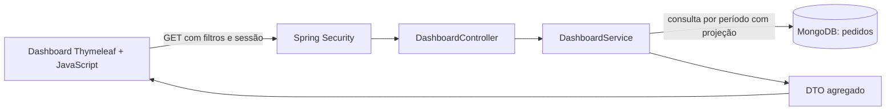

# Dashboard administrativo — Pediu Patrão

## Escopo e acesso

Painel integrado ao projeto Java 21 / Spring Boot 3.4.4 / MongoDB / Thymeleaf, disponível em `/dashboard` pelo menu **Dashboard**. ADMIN e GERENTE consultam; ATENDENTE não acessa. O painel não altera pedidos. Branch Gitflow: `feat/dashboard-administrativo`, derivada da `main` existente. Não foi realizado push nem merge.

## Requisitos funcionais

| ID | Requisito e critério de aceite |
|---|---|
| RF01 | Exibir faturamento líquido, pedidos, vendas concluídas válidas, ticket médio, cancelados e pedidos em andamento. Valores vazios devem ser zero. |
| RF02 | Exibir evolução do faturamento em gráfico de barras por dia ou mês, inclusive períodos sem vendas. Disponibilizar também tabela com quantidade e faturamento. |
| RF03 | Exibir contagem por todos os sete status, inclusive os que têm zero pedidos. |
| RF04 | Listar produtos por unidades vendidas, com Top 5, 10 ou 20; desempatar pelo ID do produto. |
| RF05 | Filtrar por data inicial, data final e situação; permitir agrupamento diário/mensal. Aplicar os mesmos filtros a todos os componentes. |
| RF06 | Consumir `GET /api/dashboard` com autenticação existente; calcular valores no servidor a partir do MongoDB. |
| RF07 | Atualizar ao abrir, ao aplicar filtros e manualmente; oferecer atualização opcional a cada 60 segundos. Exibir carregamento, vazio, inconsistências e erros de acesso/consulta. |

## Requisitos não funcionais

| ID | Requisito | Implementação / verificação |
|---|---|---|
| RNF01 | Segurança por perfil no servidor | Regras HTTP + `@PreAuthorize` no serviço; testes de 401, 403 e leitura autorizada. |
| RNF02 | Precisão monetária | `BigDecimal`, duas casas, arredondamento `HALF_UP`; preço e total vêm dos pedidos gravados. |
| RNF03 | Privacidade | DTO agregado, sem clientes, telefones, senhas ou observações. Resposta com `Cache-Control: no-store`. |
| RNF04 | Consulta limitada | Máximo 366 dias inclusivos; índice em `pedidos.dataHoraEntrada`; projeção só dos campos necessários. |
| RNF05 | Usabilidade e acessibilidade | Labels, foco visível, mensagens anunciadas, tabela alternativa ao gráfico e layout responsivo verificado em 390 × 844. |
| RNF06 | Resiliência | Timeout de 15 segundos, cancelamento de consulta anterior e descarte de resposta antiga; erro oculta resultados anteriores. Polling pausa com aba oculta. |
| RNF07 | Manutenção e testes | Controller → serviço → MongoTemplate; DTOs explícitos; testes de domínio, HTTP, segurança e MongoDB real. |
| RNF08 | Compatibilidade | Mantém Java/Thymeleaf, autenticação, cadastro de pedidos e conversão de status legados existentes; sem dependência adicional de frontend. |

## Regras de negócio e decisões

1. O período considera **data/hora de entrada**, com início inclusivo e fim exclusivo no começo do dia seguinte. Assim, um pedido às 23:59:59 do último dia participa. O fuso de negócio é `pediupatrao.timezone` (padrão `America/Sao_Paulo`). Mantenha o fuso da JVM consistente entre instâncias, pois o modelo existente persiste `LocalDateTime`.
2. **Venda** significa pedido com status atual `FINALIZADO` e total preenchido e não negativo. Faturamento é a soma de `valorTotal`, que já inclui descontos. Ticket = faturamento / quantidade dessas vendas; sem vendas, retorna zero. Isso mede vendas concluídas da coorte de pedidos recebidos no período, não fluxo de caixa nem data de pagamento.
3. Cancelados e pedidos abertos entram na contagem de pedidos e no gráfico de situações, sem compor receita ou ranking. Em andamento = RECEBIDO + EM_PREPARACAO + PRONTO + SAIU_PARA_ENTREGA + RETIRADO. O filtro de status afeta **todo** o painel: ao escolher CANCELADO, a receita é zero.
4. Série diária/mensal inclui zeros. Em MES, `periodo` é o primeiro dia do mês, mesmo que o filtro comece no meio do mês; a soma continua restrita às datas consultadas.
5. Ranking soma as quantidades dos itens de vendas válidas e agrupa por `produtoId`, sem consultar o preço ou nome atual do catálogo. Produtos excluídos continuam no histórico. Se o mesmo ID tiver nomes diferentes, usa o menor nome em ordem lexicográfica para resultado determinístico; desempates de quantidade usam ID crescente.
6. Pedidos sem valor ou com total negativo não têm receita estimada; permanecem na contagem de status. Itens sem ID ou com quantidade não positiva são ignorados no ranking. Pedido finalizado sem itens mantém seu total válido, mas gera aviso. `pedidosInconsistentes` conta cada pedido afetado uma única vez. Pedidos sem data de entrada não pertencem a nenhum período e ficam fora da consulta; não é possível atribuir-lhes uma data confiável.
7. Status legados, como `ENTREGUE`, são convertidos pelo conversor já existente antes do filtro. Status desconhecidos seguem a política antiga do sistema, que os converte em RECEBIDO; o dashboard não muda essa política.
8. Um endpoint consolidado evita quatro consultas HTTP e entrega todos os componentes a partir da mesma leitura. Filtros e regras ficam centralizados, reduzindo divergências entre gráficos e indicadores.
9. Atualização automática é opcional. Atualizar agora e o temporizador reutilizam os últimos filtros aplicados, sem aplicar edições ainda não enviadas no formulário. Por padrão, a janela dos últimos 30 dias é recalculada pelo servidor a cada consulta até o usuário aplicar datas explicitamente.

## Arquitetura e dados



O dashboard reutiliza o modelo documental existente:

| Documento/campo | Uso |
|---|---|
| Pedido.dataHoraEntrada: LocalDateTime | Período e agrupamento de vendas |
| Pedido.status: StatusPedido | Situações, elegibilidade de receita e filtro |
| Pedido.valorTotal: BigDecimal | Receita líquida e ticket |
| Pedido.itens[] | Snapshot dos produtos na venda |
| ItemPedido.produtoId, nomeProduto, quantidade | Identificação e ranking histórico |

`MongoInitConfig` assegura o índice ascendente de `dataHoraEntrada` na inicialização. Não é necessário migrar ou sobrescrever pedidos existentes. A consulta projeta apenas data, status, total e itens; agrega em memória o período selecionado. Esta solução atende uma operação de pequeno porte; ainda não foi realizado teste de carga. Para alto volume, a evolução indicada é uma pipeline de agregação MongoDB com métricas de latência e limites baseados em volume, preservando o contrato da API. Não se promete um SLA sem medições.

## Endpoints

### GET /dashboard

Tela HTML protegida, disponível para ADMIN e GERENTE. Usuário sem sessão é redirecionado para `/login`; perfil sem permissão recebe 403. O JavaScript consulta a API abaixo. Não há POST, PUT ou DELETE do dashboard.

### GET /api/dashboard

Autenticação: cookie da sessão obtido pelo login, ou HTTP Basic para curl/Postman, conforme a configuração existente. Em produção, usar HTTPS. Requisição GET não exige token CSRF. Conteúdo: `application/json`. Resposta bem-sucedida: 200 e `Cache-Control: no-store`.

| Parâmetro | Tipo | Padrão | Validação |
|---|---|---|---|
| `inicio` | Data ISO `AAAA-MM-DD` | `fim - 29 dias` | Não pode superar fim |
| `fim` | Data ISO `AAAA-MM-DD` | Hoje no fuso configurado | Não pode estar no futuro; janela inclusiva de até 366 dias |
| `status` | Enum, opcional | Todos | RECEBIDO, EM_PREPARACAO, PRONTO, SAIU_PARA_ENTREGA, RETIRADO, FINALIZADO, CANCELADO |
| `agrupamento` | String | DIA | DIA ou MES; diferencia maiúsculas/minúsculas |
| `limite` | Inteiro | 5 | De 1 a 20; a tela oferece 5, 10 e 20 |

Exemplos (a senha será solicitada pelo curl; as contas demo estão no README):

```powershell
curl.exe -u gerente01 "http://localhost:8080/api/dashboard"
curl.exe -u gerente01 "http://localhost:8080/api/dashboard?inicio=2026-11-01&fim=2026-11-06&agrupamento=MES&limite=10"
curl.exe -u admin "http://localhost:8080/api/dashboard?inicio=2026-11-06&fim=2026-11-06&status=CANCELADO"
```

Exemplo completo de resposta para dois pedidos em um dia, uma venda válida de R$ 45 e um cancelamento:

```json
{
  "inicio": "2026-11-06",
  "fim": "2026-11-06",
  "agrupamento": "DIA",
  "atualizadoEm": "2026-11-06T13:00:00",
  "indicadores": {
    "pedidos": 2,
    "vendasConcluidas": 1,
    "faturamento": 45.00,
    "ticketMedio": 45.00,
    "cancelados": 1,
    "emAndamento": 0
  },
  "vendas": [{"periodo": "2026-11-06", "quantidade": 1, "faturamento": 45.00}],
  "situacoes": [
    {"status": "RECEBIDO", "descricao": "Recebido", "quantidade": 0},
    {"status": "EM_PREPARACAO", "descricao": "Em preparação", "quantidade": 0},
    {"status": "PRONTO", "descricao": "Pronto", "quantidade": 0},
    {"status": "SAIU_PARA_ENTREGA", "descricao": "Saiu para entrega", "quantidade": 0},
    {"status": "RETIRADO", "descricao": "Retirado", "quantidade": 0},
    {"status": "FINALIZADO", "descricao": "Finalizado", "quantidade": 1},
    {"status": "CANCELADO", "descricao": "Cancelado", "quantidade": 1}
  ],
  "produtos": [{"produtoId": "pizza-1", "nome": "Pizza Calabresa", "quantidade": 1}],
  "pedidosInconsistentes": 0
}
```

`atualizadoEm` é a hora local da consulta, sem offset, no fuso configurado. Valores monetários são números JSON, formatados em reais somente na tela. Sem resultados: 200, indicadores zerados, situações zeradas, série preenchida com zeros e `produtos: []`.

| HTTP | Causa | Tratamento |
|---|---|---|
| 400 | Data/status/tipo inválido | `{"erro":"Requisição inválida: verifique o formato dos dados enviados.","status":400}` |
| 400 | Período invertido, futuro ou acima de 366 dias | `{"erro":"Informe um período de 1 a 366 dias, sem datas futuras.","status":400}` |
| 400 | Agrupamento ou limite fora dos valores aceitos | JSON com `erro` descritivo e `status: 400` |
| 401 | Ausência de autenticação ou credenciais inválidas | API não redireciona para HTML; configuração atual pode retornar corpo vazio. Tela pede novo login. |
| 403 | ATENDENTE ou tentativa de escrita | JSON com `erro` e `status: 403` na API |
| 500 | Falha inesperada, como indisponibilidade do banco durante consulta | Resposta de erro padrão do Spring; tela apresenta mensagem genérica e permite repetir |

## Executar no IntelliJ e validar

1. Abra `pom.xml` como projeto Maven e selecione JDK 21 para o projeto e o Maven Runner.
2. Inicie o MongoDB local e execute `PizzariaPedidosApplication`.
3. Entre como ADMIN ou GERENTE e acesse `http://localhost:8080/dashboard`.
4. Os usuários e produtos de demonstração existentes são criados automaticamente, mas **pedidos não são inventados pelo dashboard**. Cadastre cliente e pedido como ATENDENTE/GERENTE, avance o status como GERENTE e finalize para gerar receita.
5. No terminal PowerShell, execute:

```powershell
.\mvnw.cmd test
# Integração real: usa banco local com UUID próprio, removido no final.
$env:MONGODB_INTEGRATION = 'true'
.\mvnw.cmd verify
Remove-Item Env:MONGODB_INTEGRATION
node --check src/main/resources/static/js/dashboard.js
```

Sem a variável, os dois testes que exigem MongoDB real ficam ignorados e os demais rodam normalmente. A integração usa obrigatoriamente `localhost:27017` e banco `pediupatrao_dashboard_test_<UUID>`, nunca o banco da aplicação.

## Evidências e entrega

- [Relatório dos testes](evidencias/testes.txt): execução em 06/11/2026 com 65 testes, zero falhas, zero erros e nenhum ignorado.
- [Resposta real da API](evidencias/resposta-api.json), obtida com seis pedidos fictícios em banco separado: três vendas finalizadas, um cancelamento e dois em andamento. Total R$ 281,50 e ticket R$ 93,83.
- [Dashboard completo](evidencias/dashboard-geral.jpg), [gráficos e ranking](evidencias/dashboard-graficos.jpg), [filtro CANCELADO](evidencias/dashboard-cancelados.jpg), [agrupamento mensal com tabela](evidencias/dashboard-mensal.jpg), [período inválido](evidencias/dashboard-periodo-invalido.jpg), [layout móvel](evidencias/dashboard-mobile.jpg).
- [Servidor indisponível](evidencias/dashboard-offline.jpg): mensagem de falha de conexão em português e ocultação dos dados anteriores, verificada após encerrar o servidor de validação.
- [Roteiro da apresentação](apresentacao.md).

As capturas usam banco `pediupatrao_dashboard_validacao_20261106`, criado apenas para validação local. Nenhum dado de cliente real foi usado. O vídeo com narração própria será adicionado após a gravação. Para a entrega no Teams, envie apenas o link do repositório.
